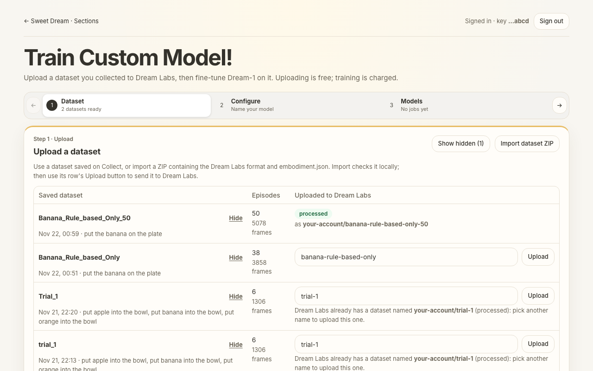

<p align="center">
  
</p>

<h1 align="center">Sweet Dream</h1>
<p align="center"><b>Diverse Data for Custom Dream-1 Fine-Tuning</b></p>
<p align="center">Collect diverse robot data in simulation, fine-tune a custom Dream-1 on it, and test the result.</p>
<p align="center">
  <a href="https://2btlfe.github.io/Sweet-Dream/#demo"></a>
  <a href="https://2btlfe.github.io/Sweet-Dream/"></a>
  <a href="docs/USAGE.md"></a>
  <a href="https://platform.dreamlabs.ai/api-documentation/"></a>
</p>

---

Dream-1 from [Dream Labs](https://dreamlabs.ai) is a robot foundation model that can be prompted with a task and
fine-tuned on your own episodes. Fine-tuning is only as good as the data: episodes must be successes, varied, and in
the right format. **Sweet Dream** is a local web app that runs the whole loop in a MuJoCo simulation of the YAM
two-arm robot:

| Step | Page | What it does |
| --- | --- | --- |
| 1 | **Collect Custom Dataset!** (`/collect`) | Run Dream-1 once or in batches over seeded scenes. A failure monitor hands a failed episode to a rule-based recovery script, so failures become successes. Success rules label every run; you can relabel by hand, pick runs, and save them as a dataset in the Dream Labs format (LeRobot v2.1). |
| 2 | **Train Custom Model!** (`/train`) | Upload a saved dataset to Dream Labs and fine-tune Dream-1 on it, with the price shown before you start. |
| 3 | **Test Custom Model!** (`/test`) | Run your fine-tuned model in the same scenes and compare it with Dream-1. |

## Screenshots

| Start · sign in | Start · pick a section |
| --- | --- |
|  |  |
| **1. Collect** · the setup in four steps, beside the camera feeds | **1. Collect** · Run settings for a batch, and the runs |
|  |  |
| **1. Collect** · a run's video, verdict and label | **2. Train** · upload a saved dataset or import a ZIP |
|  |  |
| **2. Train** · pick the dataset, steps, data mix and learning rate, and see the price | **3. Test** · run a fine-tune on its own |
|  |  |

## Highlights

- **Seeded, varied scenes.** One batch seed gives every episode its own object layout; *Vary per episode* also draws
  the workspace camera (a few cm and degrees), the light (0.8x to 1.2x) and the room. The same seed gives the same
  episodes again.
- **Failures turned into data.** The failure monitor spots a stall, a drop, a missed grasp or an object pushed away,
  and the rule-based script finishes the task (grasp, transport, set down), including a hand-over between the arms
  when only one reaches the object and only the other the target.
- **Rule-based only.** The script can also do whole episodes on its own, with no Dream-1 calls and no credits.
- **Honest labels.** Success rules per task type (pick & place, move to an area, lift, push, goal scenes), hand labels
  that win over the rules, and a record of how every run was set up.
- **Ready to train.** Saved datasets pass Dream Labs' own checks (`dream.datasets.validate_dataset`) and upload from
  the Train page.

## Results so far

| What | Result |
| --- | --- |
| Rule-based only batch, "put the banana on the plate", varied scenes | **66 of 68** valid episodes succeeded (97%) |
| Rule-based script on 4 pick-and-place tasks x 5 seeds, after the reach and hand-over fixes | 4 of 20 -> **7 of 20** succeeded |
| Data collection (Dream-1 + recovery), faster failure hand-off, same 3 seeds | 1 of 3 -> **3 of 3** succeeded |
| Banana dataset (50 unique seeds, 5,078 frames at 5 fps) | Passed the Dream Labs checks; uploaded and **processed** by Dream Labs |

Fine-tuning runs and their test results will be added here.

## Quick start

```bash
python3 -m venv ~/dream-env
~/dream-env/bin/pip install dreamlabs pyarrow av
~/dream-env/bin/python app.py --port 8000
```

Open http://localhost:8000, sign in with your Dream API key (create one at
[platform.dreamlabs.ai/api-keys](https://platform.dreamlabs.ai/api-keys)), and pick a section. The key stays in the
server's memory only. Every page and option is described in the [usage guide](docs/USAGE.md).

## Repository

| Path | What |
| --- | --- |
| `app.py` | The web server: pages, runs, batches, labels, datasets, the Train API |
| `sim.py` | One episode in the simulator: Dream-1, the failure monitor, the recovery script, the recorder |
| `monitor.py`, `recovery.py`, `teleop.py` | Failure detection, the rule-based script, and the arm control both use |
| `judge.py` | Success rules per task type |
| `scene.py`, `ood.py`, `seed_web.py` | Seeded scenes and scene settings (camera, light, arms, room) |
| `recorder.py`, `lerobot_export.py` | Episode recordings and their export to LeRobot v2.1 |
| `train.py` | Upload and fine-tuning through the Dream Labs API |
| `static/` | The pages (start, sections, collect, train, test) |
| `docs/` | The project page (GitHub Pages) and the usage guide |

## License and credits

Sweet Dream is licensed under the [Apache License 2.0](LICENSE); see [NOTICE](NOTICE).

- Built on the [Dream Labs library](https://github.com/dreamlabs-co/dreamlabs) (Apache-2.0), used as an installed
  dependency; its YAM MuJoCo example is the simulator.
- YAM robot meshes: [I2RT Robotics](https://github.com/i2rt-robotics/i2rt), MIT License.
- Apple and banana: the [YCB Object and Model Set](https://ycb-benchmarks.s3.amazonaws.com/index.html) by Calli,
  Singh, Walsman, Srinivasa, Abbeel and Dollar, [CC BY 4.0](https://creativecommons.org/licenses/by/4.0/),
  recentered and rescaled by Dream Labs, rendered here in simulation.
- Dream Labs, Dream-1 and the Dream Labs cloud mark (from which the Sweet Dream icon is drawn) are Dream Labs' names
  and marks, not covered by this license. Sweet Dream is not made or endorsed by Dream Labs.

## Acknowledgements

We thank [Nota AI GmbH](https://www.nota.ai) and [Dream Labs](https://dreamlabs.ai) for their support of this project.
