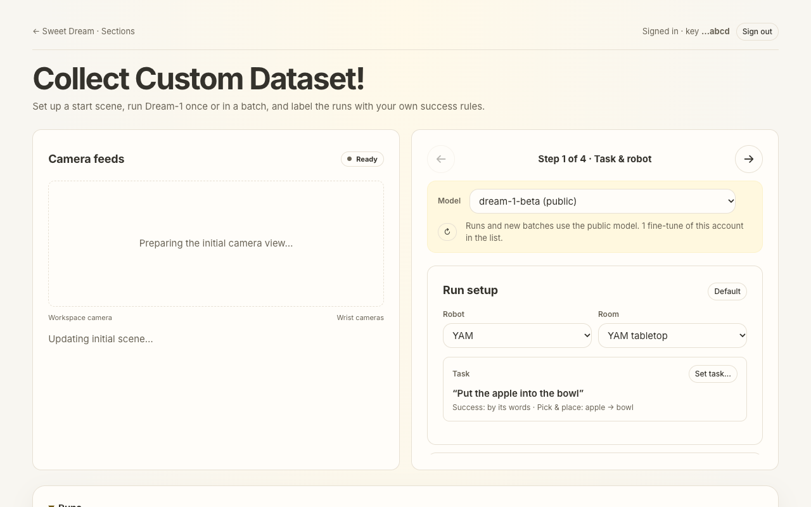
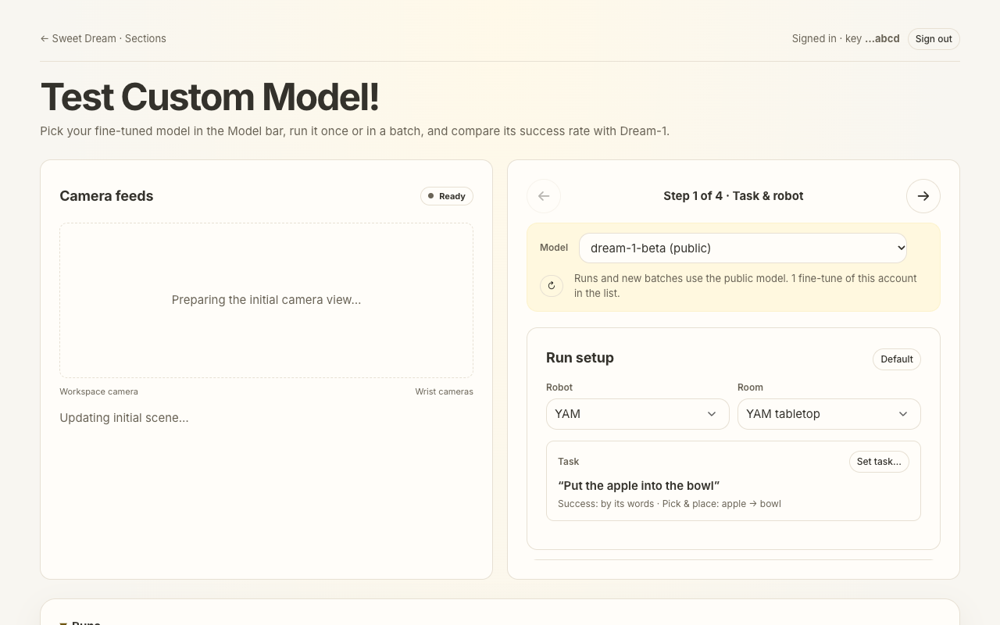
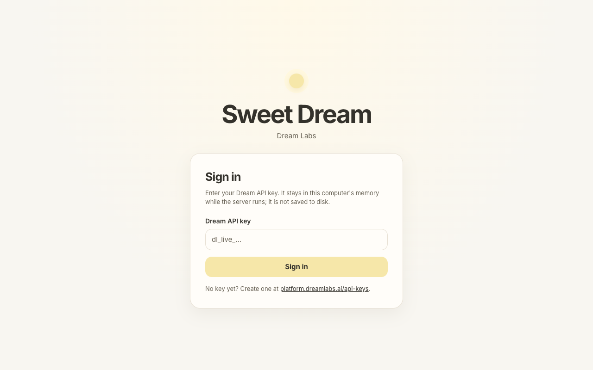
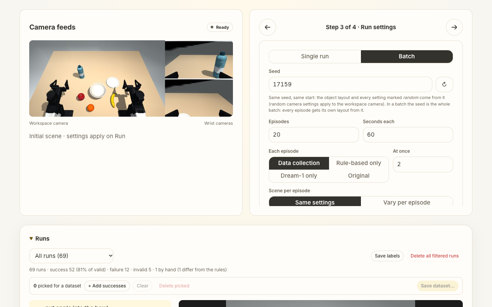
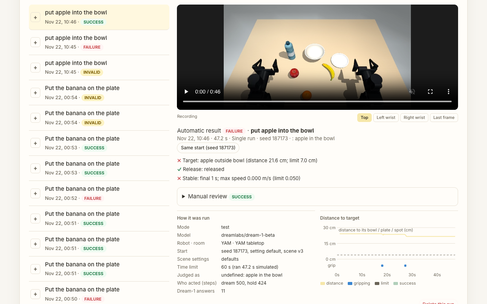
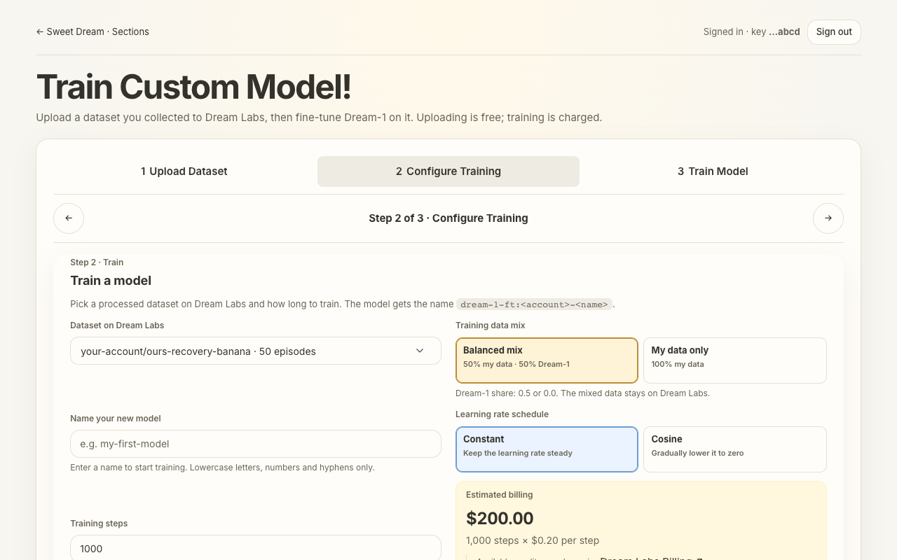
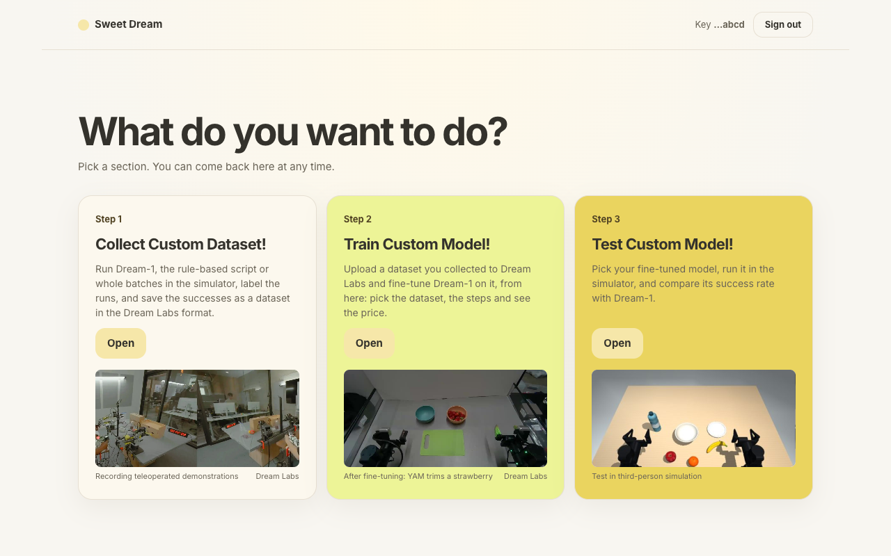
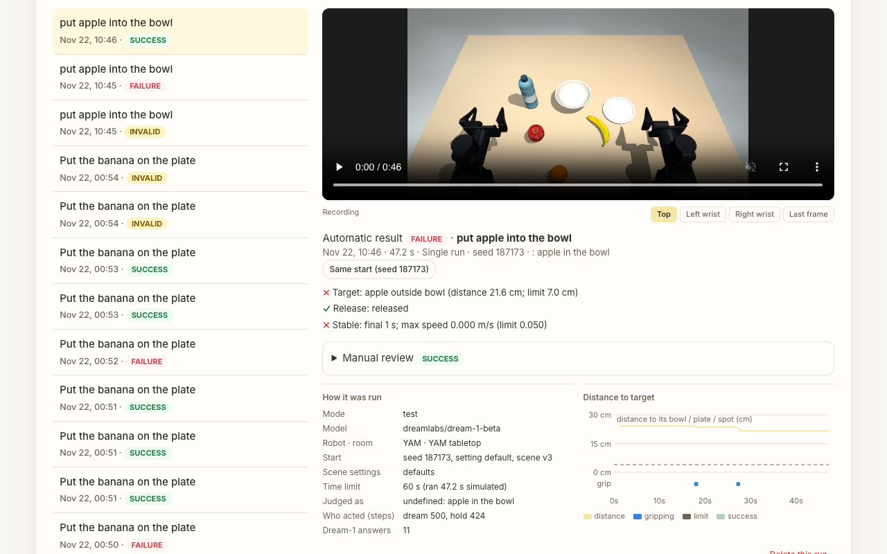

<p align="center">
  
</p>

<h1 align="center">Sweet Dream</h1>
<p align="center"><b>Diverse Data for Custom Dream-1 Fine-Tuning</b></p>
<p align="center">Collect diverse robot data in simulation, fine-tune a custom Dream-1 on it, and test the result.</p>
<p align="center">
  <a href="https://2btlfe.github.io/Sweet-Dream/#demo"></a>
  <a href="https://2btlfe.github.io/Sweet-Dream/"></a>
  <a href="docs/USAGE.md"></a>
  <a href="https://platform.dreamlabs.ai/api-documentation/"></a>
</p>

---

**Every failure becomes training data.**

[Dream-1](https://dreamlabs.ai) from Dream Labs is a robot foundation model you can prompt with a task and fine-tune
on your own episodes. A fine-tune is only as good as its data: the episodes must succeed, vary, and come in the right
format. **Sweet Dream** is a local web app that runs the whole loop, from collecting data with Dream-1 to testing your
own fine-tuned model, on the YAM two-arm robot in a MuJoCo scene.

<table>
<tr>
<td width="33%" valign="top">

### 1. Collect

**Collect Custom Dataset!** · `/collect`



- **At scale.** One batch seed varies the lighting, layout, camera angle and room for every episode.
- **Failure recovery.** A failed run is finished by a rule-based script, or by you dragging the trajectory from just
  before the failure.
- **Labeled and saved.** Success rules label every run; relabel by hand and save the runs as a Dream Labs dataset
  (LeRobot v2.1).

</td>
<td width="33%" valign="top">

### 2. Train

**Train Custom Model!** · `/train`


- **Upload.** Send a saved dataset to Dream Labs, or import one as a ZIP.
- **Set up and see the price.** Pick the steps, data mix and learning rate, and see the price before you start.
- **Fine-tune.** Fine-tune Dream-1 on your own data.

</td>
<td width="33%" valign="top">

### 3. Test

**Test Custom Model!** · `/test`



- **Your eval set.** Run your fine-tuned model on your own test set of seeded scenes.
- **Compare.** Run Dream-1 in the same scenes and compare the two.

</td>
</tr>
</table>

## Screenshots

| **Start**: Sign in with your Dream API key | **Collect**: A batch, with its run settings and runs |
| --- | --- |
|  |  |
| **Collect**: A run, with its video, verdict and settings | **Train**: Pick the dataset, steps, data mix and learning rate, and see the price |
|  |  |
| **Sections**: Choose a workflow | **3. Test**: Review a recorded evaluation |
|  |  |

## Highlights

- **Seeded, varied scenes.** One batch seed gives every episode its own object layout; *Vary per episode* also draws
  the workspace camera (a few cm and degrees), the light (0.8x to 1.2x) and the room. The same seed gives the same
  episodes again.
- **Failures turned into data.** The failure monitor spots a stall, a drop, a missed grasp or an object pushed away,
  and the rule-based script finishes the task (grasp, transport, set down), including a hand-over between the arms
  when only one reaches the object and only the other the target.
- **Rule-based only.** The script can also do whole episodes on its own, with no Dream-1 calls and no credits.
- **Honest labels.** Success rules per task type (pick & place, move to an area, lift, push, goal scenes), hand labels
  that win over the rules, and a record of how every run was set up.
- **Ready to train.** Saved datasets pass Dream Labs' own checks (`dream.datasets.validate_dataset`) and upload from
  the Train page.

## Quick start

```bash
python3 -m venv ~/dream-env
~/dream-env/bin/pip install dreamlabs pyarrow av
~/dream-env/bin/python src/app.py --port 8000
```

Open http://localhost:8000, sign in with your Dream API key (create one at
[platform.dreamlabs.ai/api-keys](https://platform.dreamlabs.ai/api-keys)), and pick a section. The key stays in the
server's memory only. Every page and option is described in the [usage guide](docs/USAGE.md).

## Repository

| Path | What |
| --- | --- |
| `src/` | The code; start the web app with `python src/app.py --port 8000` |
| `src/app.py` | The web server: pages, runs, batches, labels, datasets, the Train API |
| `src/sim.py` | One episode in the simulator: Dream-1, the failure monitor, the recovery script, the recorder |
| `src/monitor.py`, `src/recovery.py`, `src/teleop.py` | Failure detection, the rule-based script, and the arm control both use |
| `src/judge.py` | Success rules per task type |
| `src/scene.py`, `src/ood.py`, `src/seed_web.py` | Seeded scenes and scene settings (camera, light, arms, room) |
| `src/recorder.py`, `src/lerobot_export.py` | Episode recordings and their export to LeRobot v2.1 |
| `src/train.py` | Upload and fine-tuning through the Dream Labs API |
| `src/batch.py` | Batches from the command line |
| `static/` | The pages (start, sections, collect, train, test) |
| `testsets/` | Test sets: fixed scenes to test a model on |
| `tests/` | Unit tests (`python -m unittest discover tests`) |
| `tools/` | Screenshots and the demo video for the docs |
| `docs/` | The project page (GitHub Pages) and the usage guide |

## License and credits

Sweet Dream is licensed under the [Apache License 2.0](LICENSE); see [NOTICE](NOTICE).

- Built on the [Dream Labs library](https://github.com/dreamlabs-co/dreamlabs) (Apache-2.0), used as an installed
  dependency; its YAM MuJoCo example is the simulator.
- YAM robot meshes: [I2RT Robotics](https://github.com/i2rt-robotics/i2rt), MIT License.
- Apple and banana: the [YCB Object and Model Set](https://ycb-benchmarks.s3.amazonaws.com/index.html) by Calli,
  Singh, Walsman, Srinivasa, Abbeel and Dollar, [CC BY 4.0](https://creativecommons.org/licenses/by/4.0/),
  recentered and rescaled by Dream Labs, rendered here in simulation.
- Dream Labs, Dream-1 and the Dream Labs cloud mark (from which the Sweet Dream icon is drawn) are Dream Labs' names
  and marks, not covered by this license. Sweet Dream is not made or endorsed by Dream Labs.

## Team

- [Se Yeon Kim](https://www.linkedin.com/in/se-yeon-k-440760126/)
- [DaEun Lee](https://www.linkedin.com/in/daeun-lee-b41b0133a/)
- [Eunbin Lee](https://www.linkedin.com/in/eunbinlee/)
- [Seogyoung Hwang](https://www.linkedin.com/in/seogyounghwang/)
- [Yoonseo Lee](https://www.linkedin.com/in/yoonseo-lee-65307b330/)
- [ByeongCheol Lee](https://www.linkedin.com/in/byeong-cheol-lee-637311202/)

## Acknowledgements

We thank [Dream Labs](https://dreamlabs.ai) for its support of this project.
