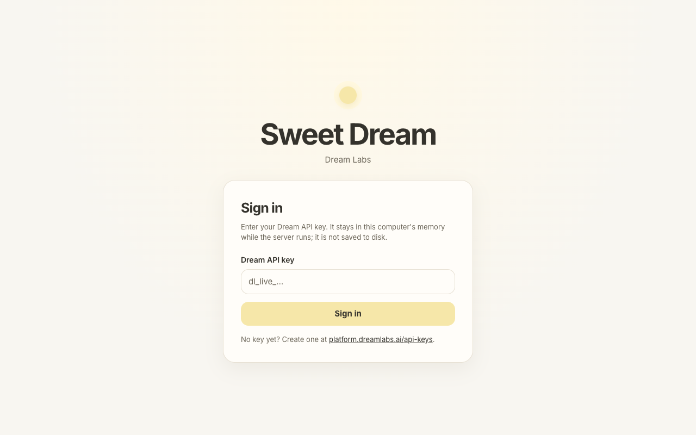
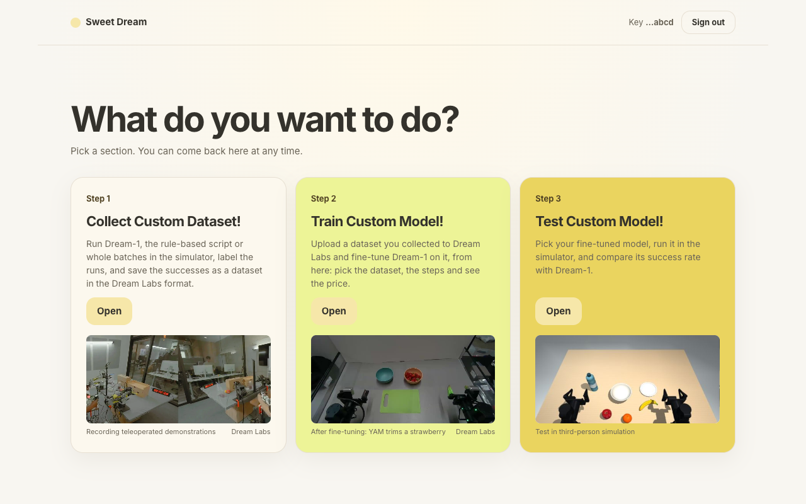
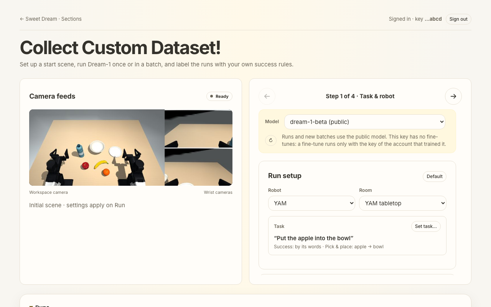
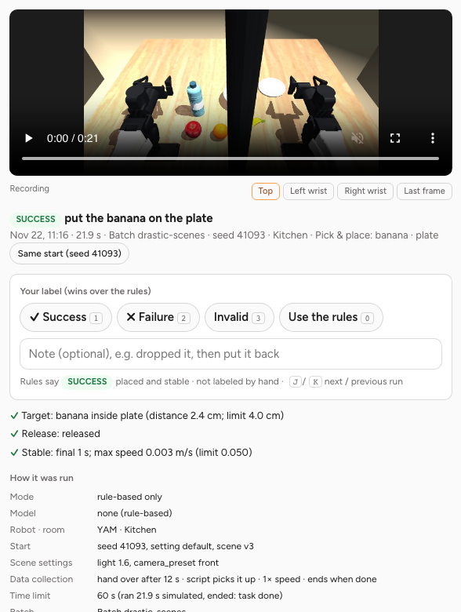
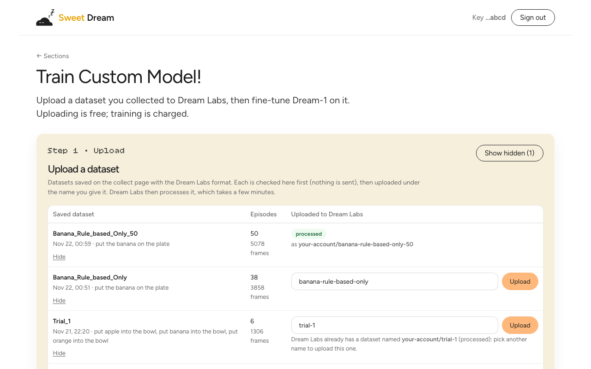
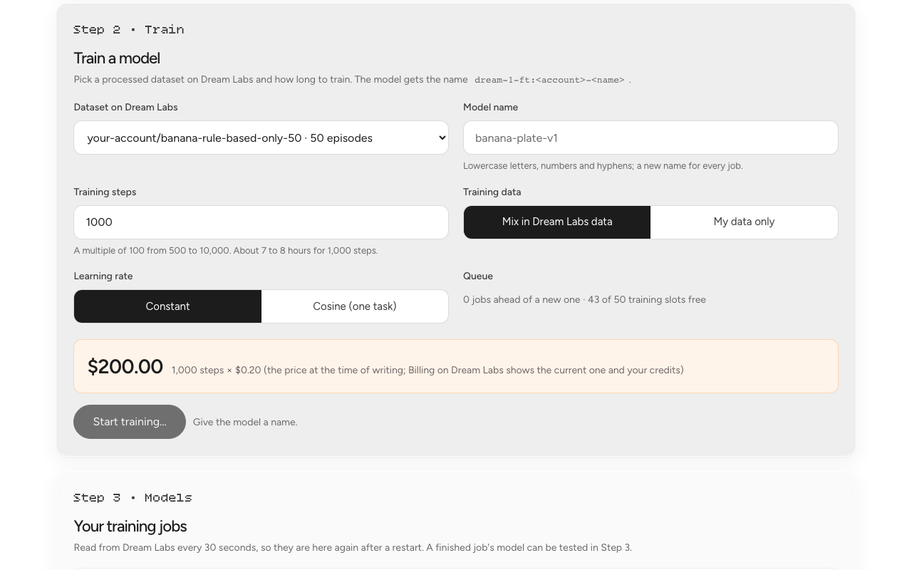
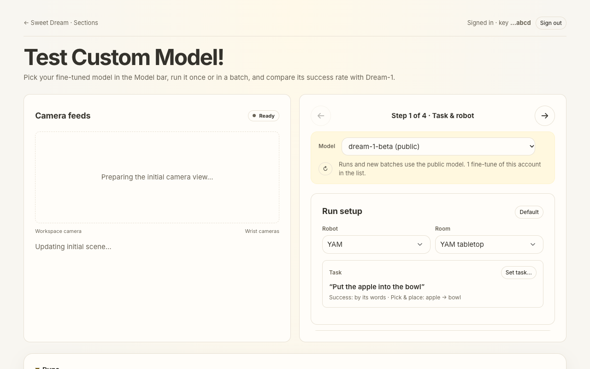
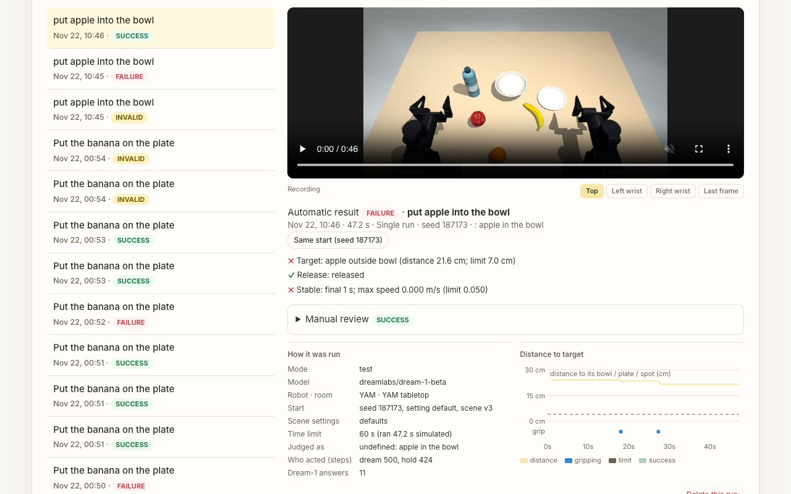

# Sweet Dream · Usage

How to use the app, page by page. For what the project is, see the [README](../README.md).
Sweet Dream adds what Dream YAM Sim leaves out of fine-tuning data: **varied scenes**, **success labels** and
**recovery**. The pages follow that loop: **Collect** → **Train** → **Test**.
Prefer to watch? The [demo video](https://2btlfe.github.io/Sweet-Dream/#demo) (3 min, narrated) shows the same steps.

**Contents:** [Start](#1-start) · [Collect](#2-collect-custom-dataset) · [Train](#3-train-custom-model) ·
[Test](#4-test-custom-model) · [Success rules](#success-rules) · [Command line](#command-line) · [Files](#files) ·
[Help](#when-something-goes-wrong)

---

## 1. Start

```bash
python3 -m venv ~/dream-env
~/dream-env/bin/pip install dreamlabs pyarrow av
~/dream-env/bin/python src/app.py --port 8000
```

1. Open **http://localhost:8000**.
2. Paste your Dream API key and press **Sign in**. (No key yet? Create one at
   [platform.dreamlabs.ai/api-keys](https://platform.dreamlabs.ai/api-keys).) Already signed in? Press **Continue**,
   or **Use another key**.
3. Pick a section and press **Open**: **Collect Custom Dataset!**, **Train Custom Model!** or **Test Custom Model!**

 

The key stays in the server's memory only. **Sign out** (top right) removes it; restarting the server does too, so you
sign in again after a restart. **← Sweet Dream · Sections** (top left) goes back to the sections.

---

## 2. Collect Custom Dataset

*Seeded scenes · labels · format check.* Run the robot in varied scenes, see which runs succeeded, and save the good
ones as a dataset that passes Dream Labs' format check.

The page has the **Camera feeds** on the left and the setup on the right, in four steps. The arrows **← / →** move
between the steps; the camera feeds show the start scene as you change the settings.



### Step 1 · Task & robot

| Setting | What it is |
| --- | --- |
| **Model** | The model that drives the arms: Dream-1 (`dream-1-beta`, `dream-1-beta-flash`) or one of your fine-tunes. **↻** reloads the list. A fine-tune runs only with the key of the account that trained it. |
| **Robot · Room** | The robot is YAM. The room changes the table and background: YAM tabletop, Kitchen, Sunny apartment, Cottage, Walnut study, Evening den. |
| **Task** | What the robot should do, in words, e.g. `put apple into the bowl`. The card shows how it will be judged. **Set task…** changes the words, and also lets you drag the objects to where they should end up (a *goal scene*). |

**Default** puts the run setup back to its defaults.

### Step 2 · Scene

**Camera, robot & environment settings**: the workspace camera's viewpoint (Overhead, Front angle, Left diagonal,
Right diagonal) and fine offsets, each arm's start angles, blur, the light and the work surface.

- Tick **random** on a setting to draw it from the seed instead of the slider. **Random from the seed: All / None**
  ticks or clears them all.
- **Reset scene settings** puts every slider back.
- **Custom layout** places the objects by hand instead of from the seed.

### Step 3 · Run settings

Choose **Single run** or **Batch**.

**Single run**: set the **Seed** (same seed, same start) and the **Limit (s)**, then a run mode:

| Mode | Who moves the arms | Needs credits |
| --- | --- | --- |
| **Data collection** | Dream-1. When it fails, the recovery script takes over. A failure it cannot recover ends the run (you can recover it later in Recordings). | Yes |
| **Rule-based only** | The rule-based script does the whole task from the first step. | No |
| **Test** | Dream-1, and you take turns with `T`. A failure hands the arms to you. | Yes |
| **Human only** | You drive from the start. `T` hands the arms to Dream-1. | Only after `T` |
| **Dream-1 only** | Dream-1 alone: no monitor, no script, no human control. | Yes |

**Data collection settings · faster successes** sets when the script takes over: after a number of seconds without
progress, and (optionally) at once on a missed grasp or an object pushed away. It also sets whether the script
**finishes the task** or **picks it up and gives it back to Dream-1**, the script's speed, and whether the run ends as
soon as the task is done.

Keep **Record to episodes/** ticked: the recording (cameras, arm states, who controlled each step) is what lets you
resume a run later.

**Batch**: many episodes in the background.


- **Episodes** and **Seconds each**.
- **Seeds: From the seed**. The seed is the whole batch: each episode gets its own layout from it, and the same seed
  gives the same episodes again.
- **Each episode**: Data collection, Rule-based only, Dream-1 only, or **Original** (the baseline: the simulator's
  default scene and settings every episode).
- **At once**: how many run side by side. More is faster overall, but Dream-1 may answer "busy" (`NO_CAPACITY`);
  those episodes are retried automatically.
- **Scene per episode**: **Same settings**, or **Vary per episode** (each episode gets its own camera, light and room).

A line under the settings sums the batch up: episodes, how many at once, the batch seed and about how long it takes.

### Step 4 · Review

**Review your run** lists the task, the success criteria, the run mode and the settings (**Detailed settings** shows
every one). Press **Run** (single run) or **Start batch**; **Stop** or **Stop batch** ends them, and **Reset** starts a single
run again from the beginning.

Each run is saved in `runs/`, and its recording in `episodes/`.

### Check and label the runs

Open **Runs** under the setup.

- The filter shows **All runs**, **Single runs**, the runs **Labeled by hand**, those where **Hand ≠ rules**, or one
  batch. The line below it counts the successes, failures and invalid runs (errors or stopped runs) it shows.
- The list is on the left; click a run to see it on the right: its **Recording** (Top, Left wrist, Right wrist, Last
  frame), the **Automatic result** and why it passed or failed, **How it was run**, and the distance to the target over
  time. **Same start** puts the run's seed and its random settings back on the page, to run that start again.

  

- Disagree with the result? Open **Manual review** and press **Success / Failure / Invalid** (keys `1 / 2 / 3`;
  **Use the rules** or `0` gives it back to the rules). Your label always wins. `J / K` move to the next / previous
  run. **Save labels** saves the labels of every run the filter shows.
- With a batch in the filter, **Run as original** runs its baseline (the same task, judge and time limit, in the
  default scene, with Dream-1 and the recovery script), and the line below the filter compares the two success rates.

### Save a dataset

1. Press **+** on the runs you want, or **+ Add successes** to pick every success the filter shows.
2. Press **Save dataset…**, give it a **Name** and choose a folder (**Open**, **Up**; the default is `datasets/`).
3. Keep **Also save in the Dream Labs format (LeRobot v2.1)** ticked: the runs are also written in the format Dream
   Labs trains on (`dream_format/`), and the format check (Dream Labs' own validator) runs on your computer.

**−** takes a run back out, **Clear** empties the pick, and **Delete picked** deletes the picked runs.

### Turn a failure into a success: Recordings

1. Open **Recordings · resume a failure** (tick **Failures only** to see just the failures) and press **Choose** on a
   run.
2. Move **Start from step** to just before it failed (**Failure point** jumps there; **− 1 s / + 1 s** fine-tune it).
3. Press **Resume here (you control)**. The scene comes back exactly as it was, and you finish the task with the mouse
   and keys (or press `T` to give it to Dream-1).

The result is a new run that starts with the original's steps.

<details>
<summary>Mouse and keys</summary>

- **Buttons:** **Take over (T)**, then **Lower → Grip (Space) → Lift**; **Switch arm (Tab)**, **Home (H)**, **Grasp:
  from above (G)**.
- **Mouse:** click an object in a camera to move a hand above it (a wrist camera moves its own arm). Drag in the top
  camera to move the hand along the table; the wheel moves it up and down.
- **Keys** (click the picture first): `W/S` away from / toward the top camera, `A/D` left / right, `R/F` up / down,
  `Q/E` turn, `Z/X` tilt, `G` grasp from above or tilted, `Space` gripper, `Tab` other arm, `V` point down, `H` arm
  home, `T` take the arms from Dream-1 / give them back.
</details>

### Delete runs

**Delete this run** (in a run's detail), **Delete all filtered runs** (everything the filter shows) or **Delete
picked**. The page asks first, and a run that is going is never deleted.

---

## 3. Train Custom Model

*Upload · fine-tune.* Fine-tune Dream-1 on a dataset you saved, without leaving the app. It uses the key you signed in with. The page has
three steps; the arrows **← / →** move between them.

 

| Step | What you do | Cost |
| --- | --- | --- |
| **1. Upload Dataset** | Your saved datasets are listed. You can also **Import dataset ZIP** (a ZIP with the Dream Labs format and `embodiment.json`); it is checked locally and added as a row. Press **Upload** on a row to send it to Dream Labs, which then prepares it (a few minutes) until it says **processed**. | Free |
| **2. Configure Training** | Pick a processed **Dataset on Dream Labs**, **Name your new model**, and set the **Training steps** (a multiple of 100 from 500 to 10,000), the **Training data mix** (**Balanced mix**: 50% your data, 50% Dream-1; or **My data only**) and the **Learning rate schedule** (**Constant** or **Cosine**). The **Estimated billing** shows before you press **Start training…**. | $0.20 per step* |
| **3. Train Model** | **Your training jobs** show their progress (read from Dream Labs every 30 seconds, so they are back after a restart). When one is done, its model (`dream-1-ft:<account>-<name>`) can be tested. | — |

\* At the time of writing; 1,000 steps take about 7 to 8 hours. A started job **cannot be cancelled**. Check your
credits on the Dream Labs [Billing](https://platform.dreamlabs.ai/billing) page; an API key cannot read the balance.

**Hide** removes a dataset from the list (nothing is deleted); **Show hidden** brings it back. If Dream Labs already
has a dataset with the same name, the row says so: rename it before uploading.

---

## 4. Test Custom Model

*Same scenes, model only.* Run a model by itself, with no recovery script and no human control, to see how good it
really is. The page has the same four steps as Collect.

 

1. In the **Model** bar (Step 1), pick your fine-tune. (The first run of a new model may wait a few minutes while it
   starts.)
2. In Step 3, run it once or as a batch. Every run is **Model only**: the result is the model's own.
3. For a fair comparison, set **Seeds** to **Test set** and pick one (from `testsets/`, or **Upload testset.json…**).
   A test set fixes the starts, the task, the judge and the time limit.
4. Run the same test set with Dream-1, then pick each batch in the **Runs** filter: the line below it gives each
   model's success rate.

Runs, labels and recordings work as on the Collect page.

---

## Success rules

How a run is judged depends on its task:

| Task type | Example | Success when, at the end |
| --- | --- | --- |
| Pick & place | `put apple into the bowl` | Each object is in its bowl or plate, let go, and still. |
| Move to an area | `push the apple to the left` | The object rests in that area. |
| Lift | `lift the apple` | The object stayed lifted long enough. |
| Push | `push the orange` | The object moved far enough along the table. |
| Goal scene | made with **Set task…** | Every moved object ends where you dragged it, within the range set there. |

The numbers for tasks without a goal scene (distance, still time, ...) are in **Advanced · success rules for tasks
without a goal scene** (Step 1); past runs are judged again. Errors and stopped runs are **invalid**, never failures.

---

## Command line

```bash
# One run: rule-based only, seed 42, in the kitchen
~/dream-env/bin/python src/sim.py "put apple into the bowl" --seed 42 --room kitchen --script-only

# One run with a fine-tuned model
~/dream-env/bin/python src/sim.py "put apple into the bowl" --model dream-1-ft:<account>-<name>

# Resume a recorded run at step 120, with you in control
~/dream-env/bin/python src/sim.py --resume <run id> --resume-step 120

# A batch from the command line (uses the key in ~/.dreamlabs/credentials)
~/dream-env/bin/python src/batch.py --repeats 10 --seconds 60
```

Runs made here show up in the app's Runs list too.

---

## Files

| File | What it does |
| --- | --- |
| `src/app.py` | The web server and every page's API |
| `static/` | The pages: start, sections, collect (`index.html`), train, test |
| `src/sim.py` | One run in the simulator |
| `src/monitor.py`, `src/recovery.py`, `src/teleop.py` | Failure detection, the rescue script, mouse / key control |
| `src/judge.py` | Success rules |
| `src/scene.py`, `src/ood.py`, `src/seed_web.py` | Seeds and scene settings |
| `src/recorder.py`, `src/lerobot_export.py` | Recordings, and the Dream Labs dataset format |
| `src/train.py` | Upload and fine-tuning through the Dream Labs API |
| `src/batch.py` | Batches from the command line |
| `testsets/` | Test sets for the Test page |
| `tests/` | Unit tests (`python -m unittest discover tests`) |
| `tools/screenshots.py` | Captures the pages for these docs (`docs/assets/screens/`), with the key and account hidden |

---

## When something goes wrong

| Problem | What to do |
| --- | --- |
| The page sends you back to sign in | The server was restarted or you signed out. Sign in again. |
| "Dream Labs refused this key" | Check the key on [platform.dreamlabs.ai/api-keys](https://platform.dreamlabs.ai/api-keys). |
| Dream-1 is busy (`NO_CAPACITY`) | Wait, or run fewer episodes at once. Batches retry by themselves. |
| The start scene cannot be built | The error banner offers **Draw again (new seed)** or **Default settings**. |
| Training refused (`payment_required`) | Not enough credits. Add some on the Billing page; nothing was charged. |

Errors appear in one banner at the top of the page; **Details** shows the full message.
