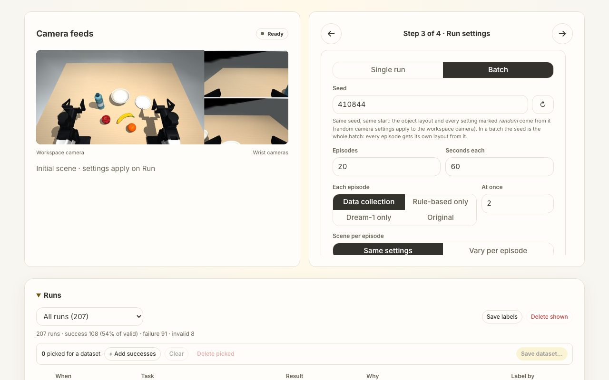

# Sweet Dream · Usage

How to use the app, page by page. For what the project is, see the [README](../README.md).
Prefer to watch? The [demo video](https://2btlfe.github.io/Sweet-Dream/#demo) (90 s, narrated) shows the same steps.

**Contents:** [Start](#1-start) · [Collect](#2-collect-custom-dataset) · [Train](#3-train-custom-model) ·
[Test](#4-test-custom-model) · [Success rules](#success-rules) · [Command line](#command-line) · [Files](#files) ·
[Help](#when-something-goes-wrong)

---

## 1. Start

```bash
python3 -m venv ~/dream-env
~/dream-env/bin/pip install dreamlabs pyarrow av
~/dream-env/bin/python src/app.py --port 8000
```

1. Open **http://localhost:8000**.
2. Paste your Dream API key and press **Sign in**. (No key yet? Create one at
   [platform.dreamlabs.ai/api-keys](https://platform.dreamlabs.ai/api-keys).)
3. Pick a section: **Collect Custom Dataset!**, **Train Custom Model!** or **Test Custom Model!**

 

The key stays in the server's memory only. **Sign out** (top right) removes it; restarting the server does too, so you
sign in again after a restart.

---

## 2. Collect Custom Dataset

Run the robot in the simulator, check which runs succeeded, and save the good ones as a dataset.


### Set up a run

| Setting | What it is |
| --- | --- |
| **Model** | The model that drives the arms: Dream-1 (`dream-1-beta`) or one of your fine-tunes. |
| **Robot · Room** | The robot is YAM. The room changes the table and background (YAM tabletop, Kitchen, Cottage, ...). |
| **Seed** | Decides where the objects start. Same seed, same start. **↻** gives a new one. |
| **Scene settings** | Camera viewpoint and angle, light, blur, table, the arms' start angles. Tick **random** to draw a setting from the seed instead. **Default** resets everything. |
| **Task** | What the robot should do, in words, e.g. `put apple into the bowl`. **Set task…** also lets you drag the objects to where they should end up (a *goal scene*). |

The camera view shows the start scene as you change these.

### Pick a run mode

| Mode | Who moves the arms | Needs credits |
| --- | --- | --- |
| **Data collection** (default) | Dream-1. When it gets stuck or drops the object, a rule-based script takes over and finishes the task. | Yes |
| **Rule-based only** | The script does the whole task by itself. | No |
| **Test** | Dream-1, and you can take over at any time with `T`. | Yes |
| **Human only** | You, with the mouse and keys. `T` hands the arms to Dream-1. | Only after `T` |
| **Dream-1 only** | Dream-1 alone, no help. | Yes |

Press **Run**. Each run is saved in `runs/`, and its recording (cameras, arm states, who acted) in `episodes/`.

### Run many episodes: Batch

Switch to **Batch** and choose:



- **Each episode**: Data collection, Rule-based only, Dream-1 only, or **Original** (the baseline: always the default
  scene and settings).
- **Episodes** and **Seconds each**.
- **At once**: how many run side by side (1 to 4). More is faster overall, but Dream-1 may answer "busy"
  (`NO_CAPACITY`); those episodes are retried automatically.
- **Seeds**: **From the seed** (one seed makes the whole batch; the same seed gives the same episodes again) or
  **Eval set (50)** (fixed seeds for fair comparisons).
- **Scene per episode**: **Same settings**, or **Vary per episode** (each episode gets its own camera, light and room).

The page shows progress, successes and the camera of each running episode. **Stop batch** stops them all.

### Check and label the runs

- The **Runs** list shows every run with its result: **SUCCESS**, **FAILURE** or **INVALID** (an error or a stopped
  run). The filter shows one batch at a time.
- Click a run to see its video, why it passed or failed, and how it was set up.

  

- Disagree with the result? Set it yourself with **Success / Failure / Invalid** (keys `1 / 2 / 3`; `0` gives it back
  to the rules). Your label always wins. `J / K` move to the next / previous run.
- **Success rules** (Advanced) sets what counts as success, per task type. See [Success rules](#success-rules).

### Save a dataset

1. Press **+** on the runs you want, or **+ Add successes** to pick every success in the list.
2. Press **Save dataset…**, give it a name and choose a folder (default: `datasets/`).
3. Keep **Dream Labs format** ticked: the runs are also written in the format Dream Labs trains on (`dream_format/`)
   and checked on your computer.

**−** takes a run back out; **Delete picked** deletes the picked runs.

### Turn a failure into a success: Recordings

In **Recordings**, choose a failed run, move the slider to just before it failed, and press **Resume here**. The
scene comes back exactly as it was, and you finish the task with the mouse and keys. The result is a new run.

<details>
<summary>Mouse and keys</summary>

- **Mouse:** click an object (the nearer arm moves above it), then **Lower → Grip → Lift**. Drag in the top camera to
  move the hand; the wheel moves it up and down.
- **Keys** (click the picture first): `W/S` forward / back, `A/D` left / right, `R/F` up / down, `Q/E` turn,
  `Z/X` tilt, `Space` gripper, `Tab` other arm, `V` point down, `H` arm home, `G` grasp style, `T` take over / give
  back.
</details>

### Delete runs

**Delete this run** (in a run's detail), **Delete shown** (everything the list shows) or **Delete picked**. The page
asks first, and a run that is going is never deleted.

---

## 3. Train Custom Model

Fine-tune Dream-1 on a dataset you saved, without leaving the app. It uses the key you signed in with.

 

| Step | What you do | Cost |
| --- | --- | --- |
| **1. Upload** | Saved datasets are listed. You can also **Import dataset ZIP** from Sweet Dream, or a LeRobot ZIP with `embodiment.json`. Import validates locally and adds a row; give it a name and press **Upload** to send it to Dream Labs. | Free |
| **2. Process** | Dream Labs prepares it (a few minutes). Wait until it says **processed**. | Free |
| **3. Train** | Pick the dataset, name your new model, set the steps (500 to 10,000), and choose the data mix: 50% Dream-1 data (`base_share=0.5`) or your data only (`base_share=0.0`). The estimated price shows before you start. | $0.20 per step* |
| **4. Follow** | Your jobs show their progress. When one is done, its model name (`dream-1-ft:...`) appears. | — |

\* At the time of writing; 1,000 steps take about 7 to 8 hours. A started job **cannot be cancelled**. Check your
credits on the Dream Labs [Billing](https://platform.dreamlabs.ai/billing) page; an API key cannot read the balance.

**Hide** removes a dataset from the list (nothing is deleted); **Show hidden** brings it back.

---

## 4. Test Custom Model

Run a model by itself, with no rescue script, to see how good it really is.


1. In the **Model** bar, pick your fine-tune. (The first run of a new model may wait a few minutes while it starts.)
2. Run it once or as a batch. Use **Eval set (50)** to compare it with Dream-1 on the same starts.

---

## Success rules

How a run is judged depends on its task:

| Task type | Example | Success when, at the end |
| --- | --- | --- |
| Pick & place | `put apple into the bowl` | Each object is in its bowl or plate, let go, and still. |
| Move to an area | `push the apple to the left` | The object rests in that area. |
| Lift | `lift the apple` | The object stayed lifted long enough. |
| Push | `push the orange` | The object moved far enough along the table. |
| Goal scene | made with **Set task…** | Every moved object ends where you dragged it. |

Each type's numbers (distance, still time, ...) can be changed in **Success rules**; past runs are judged again.
Errors and stopped runs are **invalid**, never failures.

---

## Command line

```bash
# One run: rule-based only, seed 42, in the kitchen
~/dream-env/bin/python src/sim.py "put apple into the bowl" --seed 42 --room kitchen --script-only

# One run with a fine-tuned model
~/dream-env/bin/python src/sim.py "put apple into the bowl" --model dream-1-ft:<account>-<name>

# Resume a recorded run at step 120, with you in control
~/dream-env/bin/python src/sim.py --resume <run id> --resume-step 120

# A batch from the command line (uses the key in ~/.dreamlabs/credentials)
~/dream-env/bin/python src/batch.py --repeats 10 --seconds 60
```

Runs made here show up in the app's Runs list too.

---

## Files

| File | What it does |
| --- | --- |
| `src/app.py` | The web server and every page's API |
| `static/` | The pages: start, sections, collect (`index.html`), train, test |
| `src/sim.py` | One run in the simulator |
| `src/monitor.py`, `src/recovery.py`, `src/teleop.py` | Failure detection, the rescue script, mouse / key control |
| `src/judge.py` | Success rules |
| `src/scene.py`, `src/ood.py`, `src/seed_web.py` | Seeds and scene settings |
| `src/recorder.py`, `src/lerobot_export.py` | Recordings, and the Dream Labs dataset format |
| `src/train.py` | Upload and fine-tuning through the Dream Labs API |
| `src/batch.py` | Batches from the command line |
| `tests/` | Unit tests (`python -m unittest discover tests`) |
| `tools/screenshots.py` | Captures the pages for these docs (`docs/assets/screens/`), with the key and account hidden |

---

## When something goes wrong

| Problem | What to do |
| --- | --- |
| The page sends you back to sign in | The server was restarted or you signed out. Sign in again. |
| "Dream Labs refused this key" | Check the key on [platform.dreamlabs.ai/api-keys](https://platform.dreamlabs.ai/api-keys). |
| Dream-1 is busy (`NO_CAPACITY`) | Wait, or run fewer episodes at once. Batches retry by themselves. |
| The start scene cannot be built | The error banner offers **Draw again (new seed)** or **Default settings**. |
| Training refused (`payment_required`) | Not enough credits. Add some on the Billing page; nothing was charged. |

Errors appear in one banner at the top of the page; **Details** shows the full message.
